# Домашнее задание к занятию «»Установка Kubernetes - Петр Петров

### Цель задания

Установить кластер K8s.

### Задание 1. Установить кластер k8s с 1 master node

1. Подготовка работы кластера из 5 нод: 1 мастер и 4 рабочие ноды.
2. В качестве CRI — containerd.
3. Запуск etcd производить на мастере.
4. Способ установки выбрать самостоятельно.

### Решение 1.

В рабочей среде Ubuntu 22.04.5 LTS установлен Terraform v1.13.5. Выполнена инициализация проекта командой terraform init, загружен провайдер yandex-cloud/yandex версии 0.170.0. 

Выполнена проверка синтаксиса и структуры Terraform-конфигурации
командой `terraform validate`. Ошибок не обнаружено.

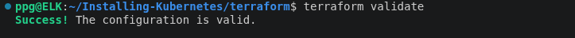

Terraform сформировал план создания 8 ресурсов:
виртуальной сети, подсети, группы безопасности и пяти виртуальных машин.

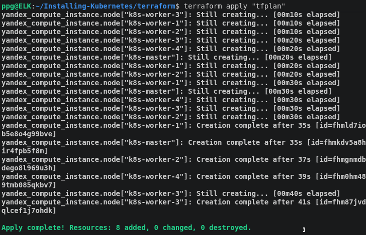

С помощью Terraform создана облачная инфраструктура
в Yandex Cloud: виртуальная сеть, подсеть, группа безопасности,
одна управляющая нода Kubernetes и четыре рабочие ноды.

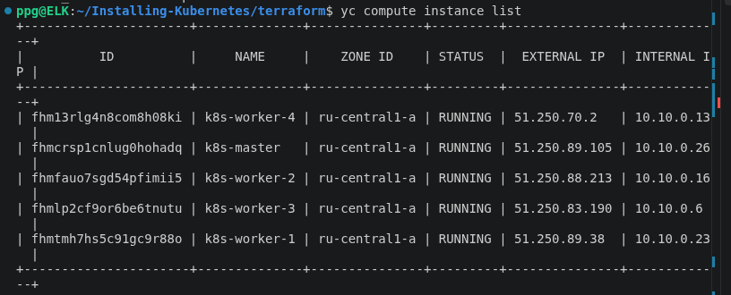

### Настройка управления серверами через Ansible

Установлен Ansible на управляющей машине ELK.
Создан Inventory с одной управляющей и четырьмя рабочими
нодами Kubernetes. Проверено SSH-подключение ко всем
пяти виртуальным машинам

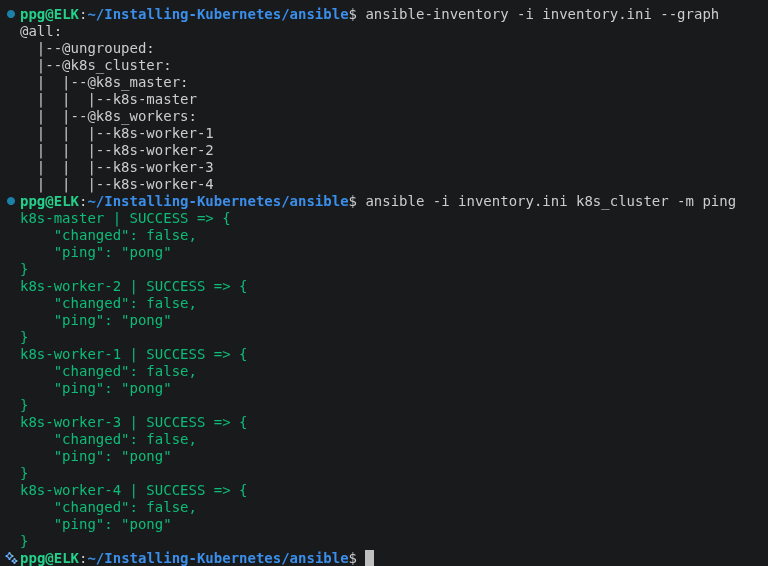

С помощью Ansible создан и выполнен Playbook prepare-nodes.yml.

На всех пяти виртуальных машинах:
- обновлён индекс пакетов APT;
- установлены системные зависимости;
- отключён Swap;
- настроена загрузка модулей overlay и br_netfilter;
- применены сетевые параметры ядра Linux.

Установка и настройка containerd на всех пяти узлах Kubernetes с включённым CRI и использованием systemd в качестве cgroup драйвера

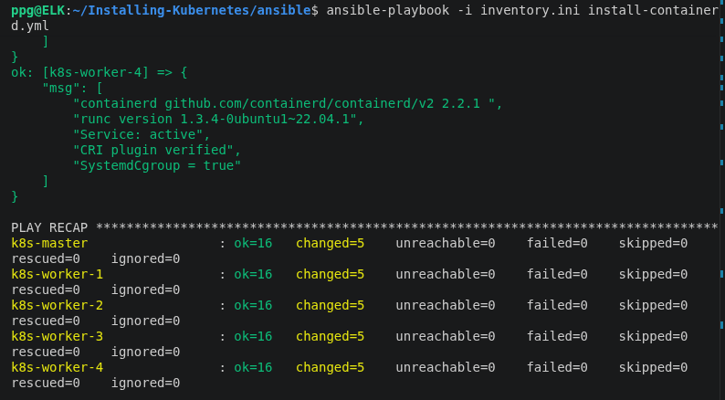

Установка Kubernetes 1.37.2 (kubeadm, kubelet, kubectl) на Control Plane и четырёх Worker-узлах. Версии пакетов зафиксированы для предотвращения непреднамеренного обновления

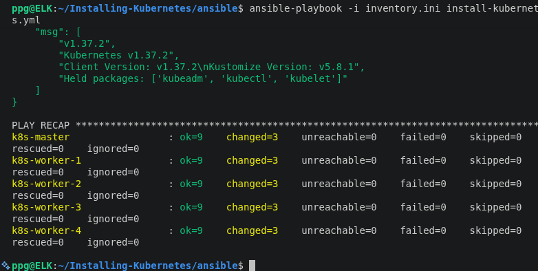

Установка сетевого плагина Flannel в Kubernetes. Созданы необходимые объекты Namespace, ServiceAccount, RBAC, ConfigMap и DaemonSet для организации Pod Network.

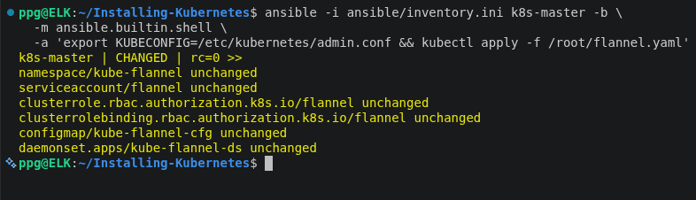

Проверка готовности Control Plane после установки Flannel. Узел k8s-master перешёл в состояние Ready, системные компоненты Kubernetes и CoreDNS работают, Pod сетевого плагина Flannel запущен.

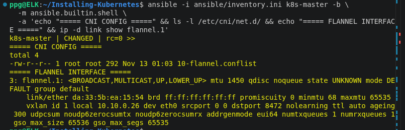

Проверка сетевой инфраструктуры Flannel на Control Plane. Подтверждено наличие CNI-конфигурации и созданного VXLAN-интерфейса flannel.1.Проверка сетевой инфраструктуры Flannel на Control Plane. Подтверждено наличие CNI-конфигурации и созданного VXLAN-интерфейса flannel.1.

Автоматизированное подключение четырёх Worker-узлов к Kubernetes-кластеру с использованием Ansible и kubeadm join. Bootstrap-токен генерируется автоматически на Control Plane и не выводится в журнал выполнения.

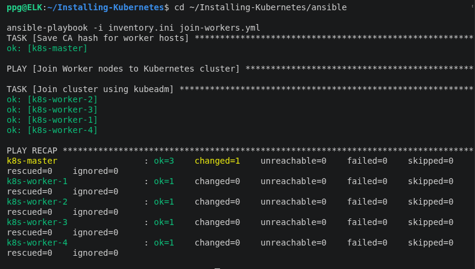

Проверка состояния Kubernetes-кластера после подключения Worker-узлов. Все пять узлов успешно зарегистрированы в кластере и находятся в состоянии Ready.

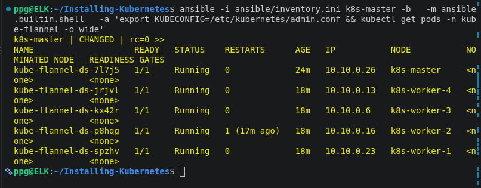

Проверка состояния Kubernetes-кластера после подключения Worker-узлов. Все пять узлов успешно зарегистрированы, используют Kubernetes v1.37.2 и находятся в состоянии Ready.

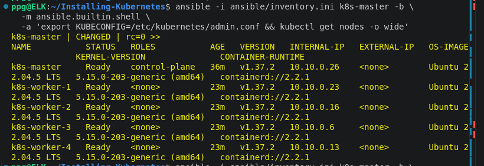

Проверка системных компонентов Kubernetes. Подтверждена работоспособность API Server, Scheduler, Controller Manager, etcd, CoreDNS, kube-proxy и сетевого плагина Flannel.

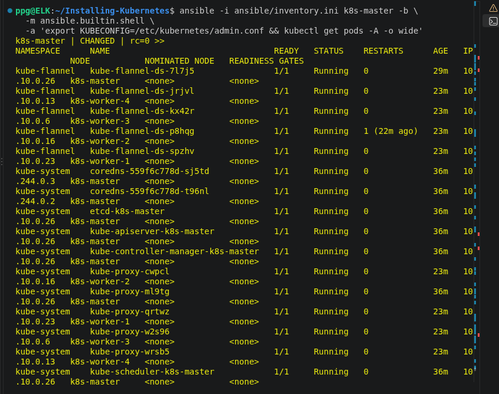